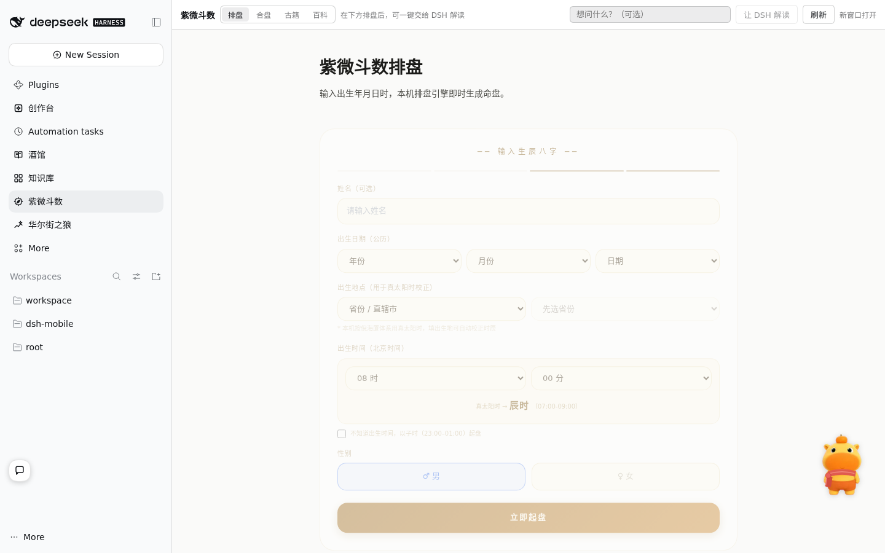

# dsh-ziwei 「紫微斗数」

**DSH 里的紫微斗数排盘面板：本地起盘，盘面直接交给 DSH Agent 解读。**

A Zi Wei Dou Shu chart panel for DSH: cast the chart locally, then hand it to the DSH agent to read.

[](package.json)
[](LICENSE)
[](https://github.com/frankfurtlin/dsh-pocket)

[中文](README.md) · [English](README.en.md)



## What it is

This plugin moves a standalone Zi Wei Dou Shu (紫微斗数) charting site into DSH. The sidebar's plugin group gains one row that opens an embedded, same-origin iframe, which serves the Next.js app running on `127.0.0.1:8815`; the reverse proxy sits behind the DSH login gate, so the app is not reachable from the public internet. Casting a chart, remembering birth data, compatibility charts, classics and the encyclopedia all live on that one page, and the "命理解读" (reading) panel on the right is generated by the host's current default model — no second API key.

The gap it closes is that a chart and a conversation used to be two different windows connected by copy-paste. The chart summary now travels through `postMessage` to the plugin's toolbar, and "Let DSH interpret" writes the whole chart into a new session's composer so you can keep asking follow-up questions.

## Features

- **Charting** — Gregorian or lunar dates, birth hour, gender and true solar time, drawn on a 4×4 palace grid that fills the panel height.
- **Readings** — `/ziwei/ai` streams from the host model over SSE, with six tabs (fate / love / career / wealth / health / character) and a follow-up box underneath.
- **Hand-off** — "Let DSH interpret" opens a new DSH session and inserts the chart summary into the composer, with a clipboard fallback.
- **Birth memory** — birth data is stored server-side in `$DSH_HOME/ziwei/birth.json` (mode `0600`), so it survives a browser switch or a cleared cache; the 20 most recent distinct people are kept.
- **Birth manager** — list all records, cast, edit or delete a single one, or clear everything; "forget" only clears the current chart.
- **Four views** — chart, compatibility (合盘), classics (古籍) and encyclopedia, each rebuilding the iframe and re-applying the shell theme.
- **Chart extras** — a collapsible overview drawer, tap-a-star explanations (classical text plus modern reading), and a share card with a link that carries the birth parameters.
- **Verifiable** — 47 browser assertions in `verify.mjs` plus 32 in `app/test-persistence.mjs`, including a 390×844 mobile layout.

## Install

```bash
# 1) The chart app: install, build, run under its systemd unit on 127.0.0.1:8815
cd app && npm install && npm run build
systemctl restart dsh-ziwei-app.service

# 2) The plugin: Plugins page → Add plugin → this repo's absolute path → Install →
#    enable the switch → reload. Manual equivalent:
#    add "dsh-ziwei": "link:/root/workspace/plugins/dsh-ziwei" to the profile's dependencies,
#    append "dsh-ziwei" to dsh.profile.bundles, then symlink node_modules/dsh-ziwei here.
```

The app's `next.config.js` sets `basePath: '/ziwei'` and `NEXT_PUBLIC_BASE_PATH=/ziwei`; both must match the proxy prefix, or the iframe loads a page with broken assets.

## Configuration

| Setting | Where | Notes |
| --- | --- | --- |
| Birth data file | `$DSH_HOME/ziwei/birth.json` | override with `DSH_ZIWEI_BIRTH_FILE`; created with mode `0600` |
| App base path | `NEXT_PUBLIC_BASE_PATH` / `basePath` | must be `/ziwei` |
| App port | `dsh-ziwei-app.service` → `127.0.0.1:8815` | the proxy target; loopback only |
| Model | none | readings use `ctx.llm.stream()` with the host's default model |
| Old AI keys | none needed | the app's own `AI_*` variables and `/api/interpret` are gone; leftovers in `.env.local` are harmless |

The birth file is a versioned document:

```json
{ "version": 1,
  "current": { "savedAt": "...", "info": { "year": 1990, "month": 6, "day": 15, "hour": 5, "gender": "male" }, "form": { "...": "raw form snapshot" } },
  "history": [ { "savedAt": "...", "info": { }, "form": { } } ] }
```

`current` restores the last chart, `history` keeps the 20 most recent distinct people (casting the same person again updates one entry instead of adding another). Each record carries an `id` derived from the birth data — it is not written to the file, so old files need no migration — which addresses single records for editing and deletion.

## Usage

Open **紫微斗数** under the plugin group; the sidebar orders it as Automation tasks(10) → 紫微斗数(16) → Skill Center(30). The toolbar's segmented control switches between chart, compatibility, classics and encyclopedia, and a range of small features sit around it:

- **Recent births** — "生辰 N ▾" lists the last five, one click swaps the chart; the form page shows the same list as pills. Stored server-side, so another browser sees them too.
- **Birth manager** — from the same menu or the form page; lists every record with the current one marked, and lets you cast, edit (form pre-filled, replaces in place) or delete one, with the "clear all" action still inside the dialog.
- **Copy chart summary** — under the toolbar's "⋯" menu; puts the digest text on the clipboard so it can be pasted into any session without opening a new one.
- **Overview drawer** — a persistent one-line summary (`命宫 · 主星 | 五行局 | 格局 N 个`) that expands into the full overview and collapses again, so it costs no permanent height.
- **Tap a star** — any star on the chart opens a panel with the classical source, a modern reading, best palaces and career/love/wealth tendencies.
- **Share** — renders a share image with `html2canvas` for download, and produces a link with birth parameters (`?b=1990-6-15-5&g=m`) that opens the same chart without retyping anything. The link outranks the stored birth data and is never written back to it.

On restore, the panel deliberately does **not** call the model: it shows "restored the chart from the saved birth data, tap a tab to interpret", and a "命格总览" is generated only after an explicit cast.

## How it works

**Host half** (`lib/index.js`) registers a `prefix /ziwei` reverse proxy to `http://127.0.0.1:8815`, after running `ctx.connection.requestRejection(req)` on every request: untrusted Host/Origin gets 403, no DSH session gets 401, and any path outside `/ziwei/*` stays 404 instead of being forwarded. `/ziwei/ai` and `/ziwei/birth` are served by the plugin's own handlers.

**Client half** (`client.js`) registers the sidebar row and the main panel, plus the toolbar and the iframe that hosts the app. Views `chart`, `heming`, `library` and `knowledge` map to `/ziwei/chart`, `/heming`, `/library` and `/knowledge`; switching rebuilds the iframe and clears the previous chart digest, so the hand-off can never pick up the wrong chart. Elements carry `data-dsh-ziwei-frame="<view>"` and `data-dsh-ziwei-tab="<view>"` attributes for the acceptance script.

**Theme** — the iframe URL carries `?theme=light|dark` taken from the shell's `color-scheme`, and a `MutationObserver` on `<html>` pushes later changes with `postMessage({type:'dsh-ziwei:theme', theme})` so the theme swaps without a reload and the chart is not lost. On the app side the first-paint priority is URL `?theme=` → localStorage → default light.

**Layout and the pet overlay** — inside the panel the app fills the iframe height (`main { height: 100vh }`, 4×4 grid rows stretched to `1fr`). The DSH pet is a fixed overlay above the iframe, so every 2 seconds the plugin measures the pet's blocking rectangle and posts `{type:'dsh-ziwei:insets', bottom, right}`; the app exposes it as `<main data-pet-insets="bottom,right">` so the assertion script can check it, and the input area shifts out from under it — otherwise a real click on the follow-up button gets swallowed by the pet.

**Mobile** (`max-width: 900px`) stacks the two columns, lets the chart stretch to the width and gives the reading panel its own 60vh scroll block; neither the chart page nor the form produces horizontal scrolling. The toolbar hides the status text and "open in new window", the question input takes a full row, and a 60px safe area is reserved for the host's menu button so the title is not covered.

## Interpretation plumbing

Readings only have one path: the plugin's `/ziwei/ai` → the host model, using the credentials and quota you already have in DSH. The app's own `InsightPanel`, `ChatPanel` and `/api/interpret` were deleted, which is also why the chart page is now a single full-width column.

- `lib/ai.js` calls `ctx.llm.stream()` with `agentDefaultModel.currentSelection()` (currently opencode-go / deepseek-v4.1-flash) and streams `{type:'delta'|'reasoning'|'error'|'done'}` events over SSE.
- The request header `x-ziwei-thread` (a page-scoped uuid) is passed down as `sessionId`; the opencode route requires `x-opencode-session` and answers 400 `MissingSessionID` without it.
- `reasoningEffort` is pinned to `low`: otherwise deepseek-v4.1 thinks for so long that nothing appears within 90 seconds. While thinking, the panel shows "the model is reading this chart… (N characters thought)".
- Thinking also consumes the output budget, so a small budget yields reasoning without prose (finish reason can be `stop` or `max-tokens` with an empty body). The first round asks for 2600 tokens and retries once at 6000 with an explicit "output the prose directly" instruction if still empty.
- Assistant messages in the history must carry `source: { kind: 'model', provider, model }`, otherwise the pi-ai adapter throws a `TypeError` in `toPiAssistant()` while reading `message.source.replayState`.

Compatibility charts use the same endpoint with `topic: "heming"`, `digest` and `digestB`; the host labels the two digests as 甲方/乙方 before composing the prompt.

## Hand-off to the agent

1. The embedded page (Next.js, `basePath=/ziwei`) casts a chart and posts a human-readable digest of the twelve palaces and four transformations to the host page (`app/chart/page.tsx` plus `lib/ziwei/digest.ts`).
2. "让 DSH 解读" calls `uiWorkspace.startSession(workspaceId, {prompt})`, then inserts the prompt into the host's Lexical composer. The host exposes no API for writing a draft, so `document.execCommand('insertText')` is used — the same path as a paste, and undoable — with a copy to the clipboard as a fallback.
3. The session opens with the full chart plus your question, and Enter starts the reading.

This requires at least one Workspace; on a fresh `DSH_HOME`, `workspaces.initializeDefault()` creates the default one first.

## Verification

```bash
scripts/check.sh            # full: static + build + isolated end-to-end instance (2–3 min)
scripts/check.sh --static   # static only: syntax, types, engine regressions (~40 s)
scripts/install-hooks.sh    # install the pre-commit hook; static check failure blocks the commit
npm run check               # node --check on lib/index.js and client.js
```

The full run starts a throwaway DSH instance under `/tmp/dsh-ziwei-check` (separate port and sessions, production untouched) and walks the panel, charting, reading, compatibility, classics, encyclopedia, sharing and birth history in a real browser, writing results to `verification/check/`. Details are in [docs/testing.md](docs/testing.md).

Running the browser scripts by hand:

```bash
# throwaway instance (the profile dir is a read-only copy of the production web profile)
DSH_HOME=/root/.dsh-ztest DSH_PASSWORDS_ENV_FILE=/root/.dsh/dsh-passwords/.env \
  setsid nohup /root/.nvm/versions/node/v24.21.0/bin/dsh \
  --profile ztest --no-open --host 127.0.0.1 --port 3099 > /tmp/ztest.log 2>&1 &

grep -o 'http://127.0.0.1:3099/?token=[A-Za-z0-9_-]*' /tmp/ztest.log | head -1
node verify.mjs --url "<that URL>" --out /tmp/ziwei-verify --ask   # --ask really clicks "let DSH interpret"
```

Production acceptance reads the token from the service log:

```bash
TOKEN=$(journalctl -u deepseek-harness.service | grep -o 'http://127.0.0.1:3080/?token=[A-Za-z0-9_-]*' | tail -1)
node verify.mjs --url "$TOKEN" --out /root/workspace/plugins/dsh-ziwei/verification/prod --ask
```

Coverage: unauthenticated 401, the sidebar row and its order, panel opening, iframe rendering, authenticated 200, casting, chart bridging, the new session, composer pre-fill, clipboard fallback, vertical fill, pet-inset sync, birth data written server-side (form snapshot and stable id, no localStorage), birth manager list/edit/delete, the reading panel, the app's old `/api/interpret` returning 404, tab switching with a fresh reading, follow-up with context not blocked by the pet, overview drawer, star detail, share card render and download, share link restoring the same chart, the four views, and a clean console.

## Development

| Change | Takes effect by |
| --- | --- |
| `client.js` (client half) | **reload the page** — the host re-assembles the `/plugins/??…` bundle from disk on every request |
| `lib/*.js` (host half) | **restart `deepseek-harness.service`** — this kills the current turn |
| `app/**` source | `npm run build` + `systemctl restart dsh-ziwei-app.service` |
| `~/.dsh/profiles/web/package.json` | restart DSH (the profile is read at startup) |

Because a restart interrupts the session, do it detached:

```bash
# usage: restart-and-verify.sh [delay seconds]
sudo systemd-run --on-active=10s --unit=dsh-ziwei-verify \
  /root/workspace/plugins/dsh-ziwei/restart-and-verify.sh
```

The script waits, restarts `deepseek-harness`, waits for port 3080, pulls the token from the journal, runs `verify.mjs --ask` and writes the report to `verification/prod/`.

Theme acceptance is its own assertion: read the shell's `color-scheme`, then the iframe's `<html data-theme>`, and require them to match. Recent screenshots are in `verification/light/`.

## Repository layout

```
package.json            # declares dsh.bundle.patch, dsh.client.platform=web, exports["./client"]
cordis.patch.yml        # - insert: [{id: dsh-ziwei, name: dsh-ziwei}], id must equal the package name
lib/index.js            # host: /ziwei reverse proxy + auth gate; /ziwei/ai and /ziwei/birth
lib/ai.js               # host: reading endpoint, ctx.llm.stream() over SSE
lib/birth-store.js       # host: birth data store in $DSH_HOME/ziwei/birth.json (0600)
client.js               # client: sidebar row + main panel, toolbar, iframe, four views
app/                    # the embedded Next.js chart application (own README and LICENSE)
verify.mjs              # browser acceptance, 47 assertions (production or test instance)
app/test-persistence.mjs # birth storage/restore/manager acceptance, 32 assertions
scripts/check.sh        # static + build + isolated end-to-end
scripts/install-hooks.sh # pre-commit hook (static check only, ~40 s)
restart-and-verify.sh   # production restart + acceptance, detached from the session
docs/                   # architecture, api, app map, testing, deploy, changelog, design review
verification/           # screenshots and generated reports
```

Dependencies: the app uses npm (`next ^16.3.8`, `react ^19.2.5`, `iztro`, `lunar-javascript`, `framer-motion`, `html2canvas`; `node_modules` is not committed). Playwright is only used for acceptance and is reused from `/root/workspace/hermes-site/tools/node_modules`, with browsers under `/root/.cache/ms-playwright`.

## Known limitations

- There is exactly one interpretation path: plugin `/ziwei/ai` → host model, billed to your own model quota. The app's `/api/interpret` is gone, so there is no second configuration.
- "Let DSH interpret" needs at least one Workspace; a brand-new `DSH_HOME` gets a default one created before the session opens.
- Draft insertion depends on the browser's `execCommand`; when it fails the flow degrades to clipboard plus manual paste.
- Restoring a chart does not re-run the model, so the first reading after a restore is a manual tab click.

## License

MIT. See [LICENSE](./LICENSE) for the plugin code.

The embedded app under `app/` keeps its own MIT `LICENSE` (Copyright (c) 2026 紫微研究), covering the chart engine and classical texts inherited from the open-source `ziwei-doushu` project; that notice stays as-is.

Commits follow [Conventional Commits](https://www.conventionalcommits.org/): `<type>(<scope>): <Chinese summary>` with `feat` / `fix` / `docs` / `test` / `build` / `chore` / `refactor` and scopes such as `host`, `client`, `panel`, `ai`, `layout`, `verify`. One commit does one thing, and anything touching code must pass `npm run check` plus the matching acceptance script first.
