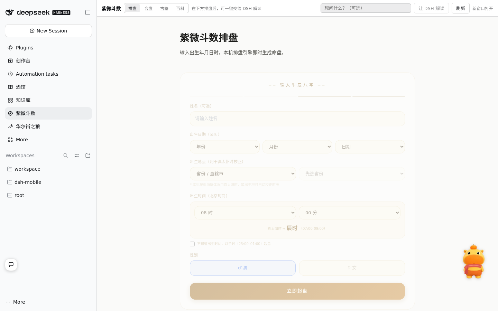

# dsh-ziwei

Zi Wei Dou Shu (紫微斗数) charting inside DSH: cast a chart locally, then hand the whole chart to the agent instead of retyping it into another window.

**English** · [简体中文](README.zh-CN.md)

[](package.json)
[](LICENSE)



## The problem

A chart and a reading used to live in two windows. You cast the chart on a site, then copied palaces and star names into a chat by hand, and whatever you forgot stayed behind.

This plugin serves the chart app behind the DSH login and lets the chart travel by `postMessage` to the panel's toolbar. **让 DSH 解读** writes the full digest into a new session's composer, so the follow-up questions happen in the same conversation.

## Quick example

```
DSH sidebar → 插件 → 紫微斗数              one new row

  排盘 · 合盘 · 古籍 · 百科               toolbar, switches the embedded view
  ┌────────────────────────────┬──────────────────┐
  │ birth form + 4×4 palace    │ 命理解读          │
  │ chart, fills the panel     │ six tabs, SSE     │
  └────────────────────────────┴──────────────────┘

让 DSH 解读 → a new session whose composer already holds the chart digest
```

## Install

```bash
# 1) the chart app: install, build, then run it under the unit that ships here
sudo git clone https://github.com/frankfurtlin/dsh-ziwei /opt/dsh/dsh-ziwei
cd /opt/dsh/dsh-ziwei/app && npm ci && npm run build

sudo cp deploy/systemd/dsh-ziwei-app.service.example /etc/systemd/system/dsh-ziwei-app.service
#   edit the copy: checkout path, NEXT_PUBLIC_SITE_URL, node interpreter when it comes from nvm
sudo systemctl daemon-reload && sudo systemctl enable --now dsh-ziwei-app
curl -s -o /dev/null -w '%{http_code}\n' http://127.0.0.1:8815/ziwei/chart

# 2) the plugin: dsh plugin add <path-to-your-checkout> (equivalently Plugins page →
#    Add plugin → this repo's absolute path → Install → enable → reload). Manual
#    equivalent: add "dsh-ziwei": "link:<path-to-your-checkout>" to the profile's
#    dependencies, append "dsh-ziwei" to dsh.profile.bundles, link it into node_modules.
```

The examples put the checkout at `/opt/dsh/dsh-ziwei`; that is a convention, not a
requirement — substitute your own path in the commands and in the unit. `next start`
exits immediately without a build, so build first and restart the unit after every
app change. Fields and permissions are documented in `deploy/systemd/README.md`.

The app must be built with `basePath: '/ziwei'` and `NEXT_PUBLIC_BASE_PATH=/ziwei` (both already set); a mismatch between either of those and the proxy prefix gives an unstyled page inside the iframe.

## Usage

Open **紫微斗数** under the plugin group. Choose a Gregorian or lunar date, birth hour, gender and true solar time, then cast; the chart fills the panel and the reading panel on the right streams into six tabs (命格 / 感情 / 事业 / 财运 / 健康 / 性格) with a follow-up box underneath.

- **让 DSH 解读** starts a new session with the digest in the composer; if the insertion fails, the digest is on the clipboard.
- Birth data is remembered server-side — **生辰 N ▾** lists the last five, and the birth manager lists, edits or deletes any record.
- **Share** renders a card and a link that carries the birth parameters (`?b=1990-6-15-5&g=m`); the link outranks stored data and is never written back to it.
- Restoring a chart deliberately does not call the model: pick a tab when you want a reading.

## Configuration

| Setting | Default | What it controls |
| --- | --- | --- |
| `DSH_ZIWEI_BIRTH_FILE` | `$DSH_HOME/ziwei/birth.json` | server-side birth store, created with mode `0600` |
| `DSH_ZIWEI_UPSTREAM_PORT` | `8815` | loopback port the `/ziwei` proxy targets |
| `DSH_ZIWEI_AI_REASONING` | `low` | reasoning effort for readings (`off`/`minimal`/`low`/`medium`/`high`); low is what keeps the first token inside 90 seconds |
| `DSH_ZIWEI_AI_DEBUG` | unset | set to `1` to log the SSE chunks of a reading |
| `DSH_HOME` | `~/.dsh` | parent directory of the birth store |
| `NEXT_PUBLIC_BASE_PATH` | `/ziwei` | build-time base path of the app; must match the proxy prefix |

There is no second API key: readings go through `ctx.llm.stream()` with whichever model DSH already has selected, billed to that quota. The app's own `AI_*` variables and `/api/interpret` are gone, and leftovers in `.env.local` are harmless.

## What it doesn't do

- It needs the companion Next.js app running on `127.0.0.1:8815`. Without it the panel renders an empty frame.
- It has no authentication of its own. `/ziwei/*` sits behind the DSH login gate (401 without a session), other paths stay 404, and the app is not reachable without that login.
- There is exactly one reading path: the plugin's `/ziwei/ai` → the host's default model, on your quota. The app's old `/api/interpret` is gone, so there is no second configuration to tune.
- **让 DSH 解读** needs at least one Workspace and relies on the browser's `execCommand` for draft insertion; when that fails the digest falls back to the clipboard.
- Restoring a saved birth restores the chart only — no reading is generated until you ask for one.
- Birth data is one JSON file for this install (`0600`): no multi-user separation and no sync between machines.

## Docs

Full design notes are in the Chinese README ([README.zh-CN.md](README.zh-CN.md)), and the long-form pages are under `docs/`: architecture and the proxy/auth chain, the `/ziwei/ai` SSE and `/ziwei/birth` API, the app capability map, testing and acceptance, deployment and rollback, the changelog, and a design review.

## Contributing

`npm run check` is the fast gate; `scripts/check.sh` adds a build and a full end-to-end run in a throwaway DSH instance (2–3 minutes, production untouched), and `scripts/install-hooks.sh` wires the static check into a pre-commit hook. Commits follow Conventional Commits with a Chinese summary.

## License

MIT — see [LICENSE](LICENSE). The embedded app under `app/` keeps its own MIT license (© 2026 紫微研究), covering the chart engine and classical texts inherited from the open-source `ziwei-doushu` project.
